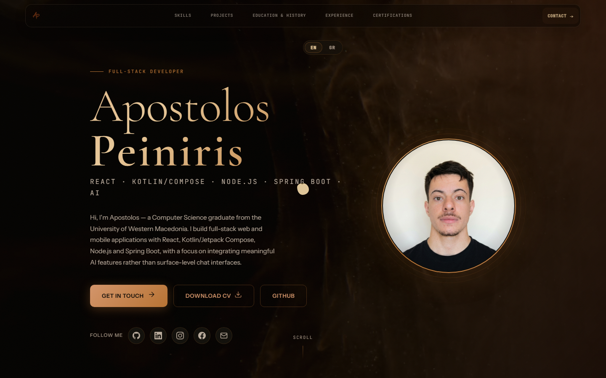

# Apostolos Peiniris

Personal portfolio. A single `index.html` with no framework and no build step.

[Live site](https://apostolos-peiniris.vercel.app) | [LinkedIn](https://www.linkedin.com/in/apostolos-peiniris-a02a961a5/)

## About

Full-stack developer in Greece (Computer Science, University of Western Macedonia). React, Kotlin and Jetpack Compose, Node.js, Spring Boot, with a focus on AI features inside real products. The site lists projects, work history and certifications, and links to a written case study.

## Contents

| Path | What |
|---|---|
| `index.html` | Markup, styles and scripts in one file |
| `case-study/` | Case study of Καλαθάκι, a price comparison app for 8 Greek supermarkets |
| `cv/` | CV |
| `assets/`, `tech-icons/` | Images, icons and media |
| `og.png`, `sitemap.xml`, `robots.txt` | Social card and SEO files |
| `vercel.json` | Static build, headers and routing |

## Implementation

GSAP with ScrollTrigger and Lenis (loaded from a CDN) drive scroll animation and smooth scrolling. Typography is Cormorant Garamond with Montserrat, Instrument Sans and JetBrains Mono from Google Fonts. English and Greek versions are switchable on the page.

## Run

Open `index.html` in a browser.