 

**A dark-copper personal site, hand-built in a single `index.html`. No framework, no build step.**

 

## About

Full-stack developer from Greece (CS, University of Western Macedonia). React, Java/Spring Boot, PostgreSQL, Kotlin/Compose, Node. This site is the front door: projects, a written case study, downloadable CVs and a contact path.

## What's inside

| Path | What |
|---|---|
| `index.html` | The whole site: markup, styles and scripts in one file |
| `case-study/` | Deep dive on Καλαθάκι: 71.000+ prices from 8 Greek supermarkets |
| `cv/` | CV PDFs |
| `tech-icons/`, `assets/` | Icons and media |
| `og.png`, `sitemap.xml`, `robots.txt` | Social card and SEO basics |
| `vercel.json` | Headers and routing |

## Craft notes

- Custom cursor interactions, GSAP + ScrollTrigger scroll animation and Lenis smooth scrolling (loaded from CDN)
- Static assets served straight from Vercel: fast first paint, nothing to build
- Semantic markup with SEO metadata, sitemap and Open Graph card

## Run locally

Open `index.html` in a browser. There is no build step.

Designed and built by Apostolos Peiniris
